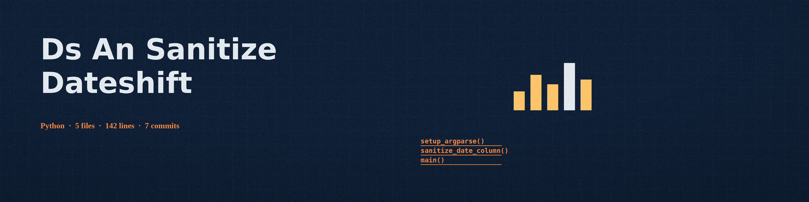

# ds-an-sanitize-DateShift
Shifts all dates within a specified column by a random number of days within a defined range, preserving the overall date relationships but obscuring the original dates. Relies on the `python-dateutil` library for date parsing. - Focused on Provides tools for masking, anonymizing, and redacting sensitive data in datasets or log files. Generates realistic fake data, applies regular expressions for redaction, and ensures data privacy compliance. Focuses on protecting PII and sensitive information.

## Install
`git clone https://github.com/ShadowGuardAI/ds-an-sanitize-dateshift`

## Usage
`./ds-an-sanitize-dateshift [params]`

## Parameters
- `-h`: Show help message and exit
- `--min_shift`: No description provided
- `--max_shift`: No description provided

## License
Copyright (c) ShadowGuardAI

## Notes
- The output file must not be the input file. A run that names the input as the output is refused at exit 1 before any file is written.
- The tool prints how many dates were shifted and how many were not. A run where no value in the named column could be parsed and shifted exits 1, writes no output file, and does not print the success line.
